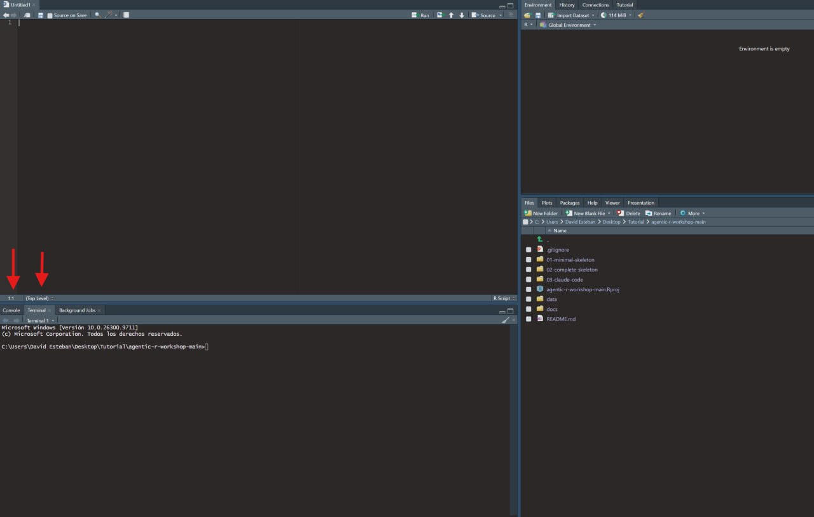

# Agentic R — build your first AI agent in R

Workshop material for **"Agentic R"** (R Users Group).

This is a **complete beginner guide**. If you have never used an "AI agent" before, you
are in the right place. Follow the steps in order and you will have an agent writing and
running real R code on your own computer in about 15 minutes.

> **What is an agent?** An AI model (like ChatGPT) that you give **tools** (your own R
> functions) and let it work in a loop: it reads your request, runs your R code, looks at
> the result, and answers. In this repo the "agent" is a tiny program called **Rho**.

---

## 0. Two things you'll use: R and the Terminal

Through this guide you type commands in **two different places**. Don't mix them up:

| Where | What it is | What you type there |
|---|---|---|
| **The R console** | The pane with a `>` prompt, inside **RStudio** | R commands, like `install.packages("ellmer")` or `source("agent.R")` |
| **The Terminal** | A window of your operating system with a `$` or `>` prompt | System commands, like `ollama pull qwen2.5:3b` |

**Good news: RStudio has both.** In the bottom-left pane there is a **Console** tab (that's R)
and, right next to it, a **Terminal** tab (the system terminal). You can do almost everything
from this one window, the two red arrows below point to each:



> Prefer a separate system terminal? On **Mac** press `Cmd + Space`, type `Terminal`, Enter.
> On **Windows** press Start, type `PowerShell`, Enter.

Whenever a step says *"in the R console"*, use the **Console** tab (or pane). When it says
*"in the Terminal"*, use the **Terminal** tab (or a separate system terminal).

---

## 1. Install the four things you need (one time)

Install these in order. Each is a normal installer, just download and click through.

1. **R** (the language itself) → https://cran.r-project.org/
   Pick your system (Windows / macOS), download, install.

2. **RStudio** (a friendly window to use R) → https://posit.co/download/rstudio-desktop/
   Download the free version and install. **You will write R here.**

3. **Ollama** (lets you run AI models on your own computer, free) → https://ollama.com/download
   Download, install, and open it once. On Mac it shows a small icon in the top menu bar;
   on Windows it runs in the background. Leave it running.
   **Or install it from the terminal** (works on all systems):
   ```bash
   # macOS / Linux
   curl -fsSL https://ollama.com/install.sh | sh
   # Windows PowerShell
   irm https://ollama.com/install.ps1 | iex
   ```

4. **Claude Code** (an external AI agent, only needed for folder `03`) → https://claude.com/claude-code
   Per-terminal install commands (CMD, PowerShell, bash, npm, or from inside R) are in
   **section 6** below. You will need a (free or paid) Claude account to sign in.
   *You can skip this one for now and still do folders 01 and 02.*

---

## 2. Download this repository

**Option A (easiest):**
1. Go to https://github.com/derebellon/agentic-r-workshop
2. Click the green **`Code`** button → **Download ZIP**.
3. Unzip it. You now have a folder called `agentic-r-workshop`. Remember where it is
   (e.g. your Desktop).

**Option B (if you know git):** `git clone https://github.com/derebellon/agentic-r-workshop`

Inside you will find:

```
agentic-r-workshop/
├─ setup.R                 one-command installer (run this first, see section 3)
├─ data/                   the example patient data (cohort.csv)
├─ 01-minimal-skeleton/    an EMPTY agent, to learn the pieces
├─ 02-complete-skeleton/   a WORKING agent (start here!)
├─ 03-claude-code/         the same agent, run with Claude Code
└─ docs/                   this tutorial + the talk slides
```

---

## 3. One-time setup (do this once)

### The easy way — one command

In RStudio, set the working directory to the `agentic-r-workshop` folder
(**Session → Set Working Directory → Choose Directory…**), then in the **R console** run:

```r
source("setup.R")
```

It installs `ellmer`, installs Ollama and downloads the model, and installs **Claude Code**
(adding it to your PATH automatically), then checks that everything works. **Run it from the R
console, not the Terminal** — the script detects your operating system and picks the right
commands itself (so you don't need to know PowerShell vs bash).

- It should **not** ask you questions. The one exception: if Ollama wasn't installed yet, its
  installer may ask for your computer's **admin password** (that's normal, it's installing an app).
- On Windows, if it says Ollama isn't visible yet, do **Session → Restart R** and run
  `source("setup.R")` again.

When the check shows everything `OK`, jump to **section 4**.

That one command should install everything on the first try. **But if the final check does
_not_ show all `OK`** (something is marked `MISSING` or `not downloaded`), open the manual steps
below and run **only the piece that failed** — you don't need to redo the ones that already
worked.

<details>
<summary><b>Manual install — run only the step that failed</b></summary>

**3a. Install the `ellmer` package — in R.**
Open **RStudio**. In the **R console** (the pane with `>`), type this and press Enter:
```r
install.packages("ellmer")
```
Wait for it to finish (it may take a minute).

**3b. Download a local AI model — in the Terminal.**
Open the **Terminal** (see section 0) and type this, then press Enter:
```bash
ollama pull qwen2.5:3b
```
This downloads a small AI model (~2 GB) to your computer. One time only.

> Want to see the model work on its own? In the Terminal type `ollama run qwen2.5:3b`,
> chat with it, and type `/bye` to exit. (This is optional.)

> **Shortcut, do it all from RStudio.** Every command marked *"in the Terminal"* also works
> in RStudio's **Terminal tab** (bottom-left, next to Console), so you never leave the window.
> You can even run them from the **R console** with `system()`:
> ```r
> system("ollama pull qwen2.5:3b")                       # download the model
> system("npm install -g @anthropic-ai/claude-code")      # install Claude Code (needs Node.js)
> ```
> Even **Ollama itself** installs from the terminal, so the whole setup can happen inside
> RStudio's Terminal tab:
> `curl -fsSL https://ollama.com/install.sh | sh` (Mac/Linux) or
> `irm https://ollama.com/install.ps1 | iex` (Windows PowerShell).

</details>

---

## 4. Run the working agent — folder `02` (START HERE)

This is the fun part. The agent **Rho** will build a table and run a statistical model on
example patient data, just by asking in plain English.

1. Open **RStudio**.
2. Tell RStudio to work inside the `02-complete-skeleton` folder:
   **Session menu → Set Working Directory → Choose Directory…** then select
   `agentic-r-workshop/02-complete-skeleton` and click Open.
3. In the **R console**, type this and press Enter:
   ```r
   source("agent.R")
   ```
   You should see `Agent 'Rho' ready.`
4. Now **talk to the agent**. Type, in the R console:
   ```r
   ask("Give me Table 1 comparing by treatment, with p-values")
   ```
   Watch it: it calls a tool, builds the table with the `gtsummary` package (installing it
   if needed), and shows you the result. A file `table.html` is also saved in the folder.
5. Ask it something harder:
   ```r
   ask("Which variables are associated with higher mortality?")
   ```
   It fits a logistic regression and tells you the Odds Ratios (you should see that
   **comorbidities** and **treatment 2** raise mortality, and **treatment 1** lowers it).

That's it, you just used an AI agent to do real analysis, all on your own computer.

> **First answer is slow?** The very first question loads the model into memory and takes a
> few seconds. The next ones are fast.

---

## 5. Build your OWN agent — folder `01`

Folder `01-minimal-skeleton` is the **same program but empty**, so you can see how simple it
is and make it yours. It has three files:

| File | What it is | What you do with it |
|---|---|---|
| `soul.md` | Who the agent is and its rules (plain text) | **Edit it** to describe your agent |
| `tools.R` | The R functions the agent can run | **Add your own functions** here |
| `agent.R` | The engine (the loop). | **Don't touch it.** |

### What's a tool, and why?

A **tool** is how you give the agent *hands* and teach it *your* way of working. Why bother?

- A plain AI model only predicts text, it **can't touch your data or run code**. Tools let it act.
- When you ask for a table, it runs **real R** instead of **inventing numbers**.
- It uses **your** libraries and conventions (here `gtsummary` and `glm`), so results are
  reproducible, not random code.

A tool has **three parts**. The model never sees your code, only the **description**, and
from it decides *when* to call the function:

```r
# 1. The FUNCTION, the real R that does the work
make_table <- function(compare_by = NULL) {
  gtsummary::tbl_summary(data, by = compare_by) |> gtsummary::add_p()
}

# 2 + 3. Wrap it with a DESCRIPTION and typed ARGUMENTS
tool(
  make_table,
  "Build a Table 1 with gtsummary. Use compare_by to compare groups.",  # <- what the model reads
  compare_by = type_string("the variable to compare by")                # <- a typed input
)
```

That's the whole trick: write the function, describe it well, register it. See `tools.R` in
`02-complete-skeleton` for the full, working versions.

To try it:
1. In RStudio, set the working directory to `01-minimal-skeleton` (as in step 4.2).
2. In the R console: `source("agent.R")` then `ask("What time is it?")`.
   It only knows one example tool (the time) for now.
3. Open `soul.md` and `tools.R` in RStudio (just click them in the Files pane), edit them,
   save, and `source("agent.R")` again to reload. Compare with the filled-in versions in
   `02-complete-skeleton` to see where you're headed.

---

## 6. The same agent with Claude Code — folder `03`

Folder `03-claude-code` runs the **same idea** but with **Claude Code**, a much more capable
external agent (it uses Claude in the cloud). You need Claude Code installed (section 1.4).

> **Already ran `setup.R` (section 3)?** Then Claude Code is installed and on your PATH, skip
> to step 2. Otherwise, install it now:

1. **Install Claude Code**, pick the command for your terminal:
   ```bash
   # macOS / Linux (Terminal)
   curl -fsSL https://claude.ai/install.sh | bash

   # Windows PowerShell
   irm https://claude.ai/install.ps1 | iex

   # Windows CMD
   curl -fsSL https://claude.ai/install.cmd -o install.cmd && install.cmd && del install.cmd

   # Any system with Node.js (works everywhere)
   npm install -g @anthropic-ai/claude-code

   # From inside R (it shells out to your system)
   system("npm install -g @anthropic-ai/claude-code")
   ```
   **Windows: if `claude` is "not recognized"** after installing, the program is in
   `%USERPROFILE%\.local\bin` but not on your PATH yet. Run this in **PowerShell**, then close
   and reopen the terminal:
   ```powershell
   $userPath = [Environment]::GetEnvironmentVariable("Path", "User")
   $claudePath = "$env:USERPROFILE\.local\bin"
   if (($userPath -split ';') -notcontains $claudePath) {
       [Environment]::SetEnvironmentVariable("Path", "$userPath;$claudePath", "User")
   }
   ```
2. Open the **Terminal**.
3. Go into the folder. Type `cd ` (with a space), then drag the `03-claude-code` folder from
   your file explorer into the Terminal window (it pastes the path), then press Enter.
   It looks like:
   ```bash
   cd /Users/you/Desktop/agentic-r-workshop/03-claude-code
   ```
4. Start Claude Code by typing:
   ```bash
   claude
   ```
   (The first time, it will ask you to sign in, follow the prompts.)
5. Now just **type your request in plain English**, for example:
   ```
   Give me Table 1 comparing by treatment, with p-values
   ```
   Claude Code reads the instructions in `CLAUDE.md`, writes an R script, runs it, and shows
   you the result, fixing itself if something fails.

> **Harness casero vs. agente externo:** folders 01–02 are a tiny agent you run yourself in
> R; folder 03 is a ready-made external agent. Same concept, more power out of the box.

---

## 7. The example data

`data/cohort.csv` is **fake, safe, reproducible** patient data (400 people). It was built so
the agent will "discover" things we already know are true:

- **Comorbidities** → higher mortality (OR ≈ 3.8)
- **Treatment 1** → lower mortality (OR ≈ 0.26)
- **Treatment 2** → higher mortality (OR ≈ 2.0)
- **Age** → higher mortality · **Sex** → no real effect

---

## 8. Something not working?

| Problem | Fix |
|---|---|
| `could not find function "ask"` | Run `source("agent.R")` first, in the right folder. |
| `Model "qwen2.5:3b" is not installed` | In the Terminal: `ollama pull qwen2.5:3b`. |
| Nothing happens / connection error | Make sure the **Ollama app is open and running**. |
| `ellmer` errors | In R: `install.packages("ellmer")` again. |
| First answer is very slow | Normal, the model is loading. Ask again, it's fast after that. |
| Want a more powerful model | In the Terminal `ollama pull qwen3:4b`, then in R before `source`: set it with `Sys.setenv(AGENT_MODEL="qwen3:4b")`. |

---

*Workshop prepared by David Rebellón Sánchez. Full concept walkthrough in `docs/tutorial.html`
(open it in your web browser).*
